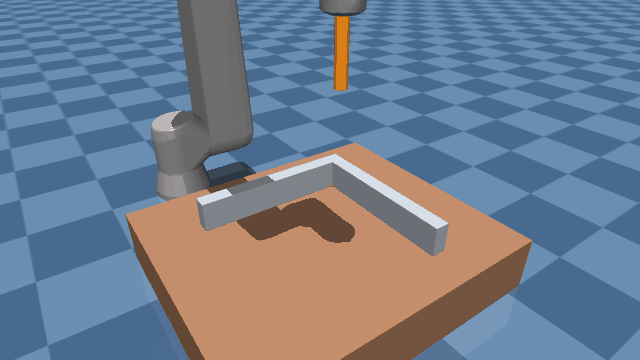
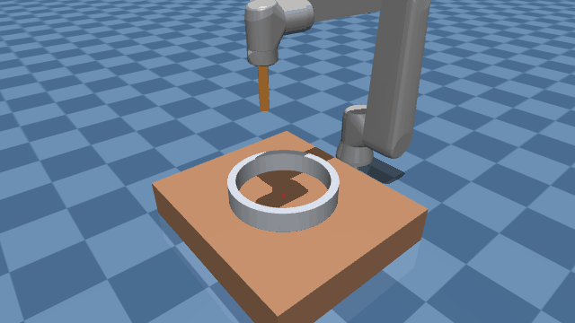
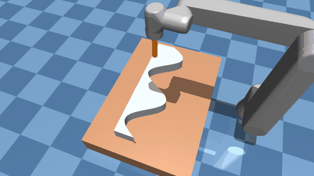
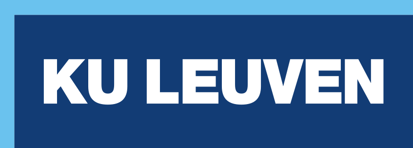

# Crospi Application Template


This package was created to be able to develop constraint-based reactive robot behaviors with eTaSL that can fully operate with the ROS2 architecture. This is a template that facilitates development and provides development functionalities to speed up development and deployment with Crospi.


## Force-control demos with the MuJoCo simulator

These demos run force-controlled tasks on a simulated UR10e with a cylindrical contact tool (15 cm long, Ø3 cm), using the [mujoco_robotsimulator_crospi](https://github.com/Robotics-Research-Group-KUL/mujoco_robotsimulator_crospi) plugin. The contact wrench of the tool is fed back to eTaSL as a force/torque sensor at `tool0` (`FT_sensor_frame`), which is located at the same place as the UR10e internal force/torque sensor. For the simulator itself (basic free-space examples, environments, configuration), see its README.

Each demo consists of:

- a setup file in [applications/application_mujoco_examples_ur10e/](applications/application_mujoco_examples_ur10e/),
  which selects the MuJoCo environment (from `mujoco_robotsimulator_crospi/config/environments/`);
- a BeTFSM python script and its task list (`.json`, same name) in
  [skill_specifications/libraries/skill_lib_example/](skill_specifications/libraries/skill_lib_example/), which use the
  task specifications of `core_task_lib` and `force_control_task_lib`.

### Build

```bash
cd <your_ws>            # workspace with this package, mujoco_robotsimulator_crospi and Universal_Robots_ROS2_Description
colcon build --symlink-install --packages-up-to crospi_application_template mujoco_robotsimulator_crospi ur_description
source install/setup.bash
```

Source the workspace in every new terminal. In bash, the `$` of `$[package]` paths must be escaped (`\$[...]`), as in
the commands below. Every demo uses three terminals: the crospi_node with the simulator, the MuJoCo viewer and the
BeTFSM script.

### Demo 1: corner localization with guarded motions

The tool localizes an inside corner formed by two walls on a table (environment `guarded_motions/table_with_corner.xml`). The script moves home, approaches the table with a Cartesian motion, and then performs guarded motions until contact: down to the table (z), against the first wall (x) and against the second wall (y), keeping a contact force with the surfaces already found. The sequence is repeated forever (Ctrl-C to stop the script).




*Recorded run of the demo (first loop, 2x real time).*

```bash
# Terminal 1: crospi node with the corner environment
ros2 run crospi_core crospi_node --ros-args \
    -p config_file:="\$[crospi_application_template]/applications/application_mujoco_examples_ur10e/ur10e_guarded_motions.setup.json" \
    -p simulation:=true

# Terminal 2: viewer (red arrows: contact forces, key T for transparency; Ctrl + right-drag: push the robot)
PYGLFW_LIBRARY_VARIANT=x11 ros2 run mujoco_robotsimulator_crospi mujoco_viewer.py \
    --model-topic /mujoco_sim/model --state-topic /mujoco_sim/state --render-rate 60 \
    --wrench-topic /mujoco_sim/external_wrench_mouse_interaction --force-stiffness 200 --torque-stiffness 20 \
    --contact-topic /mujoco_sim/contacts --contact-arrows per_body_pair --force-arrow-scale 0.025 --force-arrow-width 0.004

# Terminal 3: BeTFSM script (must be run from its own folder: it loads its task list relative to the current directory)
cd <your_ws>/src/crospi_application_template/skill_specifications/libraries/skill_lib_example/guarded_motion_sequence
python3 guarded_motion_sequence.py
```

### Demo 2: circular contour following

The tool follows the inside of a circular ring wall (inner diameter 0.35 m) on a table (environment `contour_following/table_with_circular_contour.xml`). The script moves home (above the contour), makes a guarded motion down to the table, moves up so that the tool no longer touches the table, makes a guarded motion until contact with the contour, and then follows the contour with force control (`2D_contour_following` task of `force_control_task_lib`). It runs once.




*Recorded run of the demo (3x real time).*

```bash
# Terminal 1: crospi node with the circular contour
ros2 run crospi_core crospi_node --ros-args \
    -p config_file:="\$[crospi_application_template]/applications/application_mujoco_examples_ur10e/ur10e_contour_following_circular.setup.json" \
    -p simulation:=true

# Terminal 2: viewer
PYGLFW_LIBRARY_VARIANT=x11 ros2 run mujoco_robotsimulator_crospi mujoco_viewer.py \
    --model-topic /mujoco_sim/model --state-topic /mujoco_sim/state --render-rate 60 \
    --wrench-topic /mujoco_sim/external_wrench_mouse_interaction --force-stiffness 200 --torque-stiffness 20 \
    --contact-topic /mujoco_sim/contacts --contact-arrows per_body_pair --force-arrow-scale 0.025 --force-arrow-width 0.004

# Terminal 3: BeTFSM script
python3 <your_ws>/src/crospi_application_template/skill_specifications/libraries/skill_lib_example/circular_contour_following_example/circular_contour_following_example.py
```

### Demo 3: large sine contour following

The tool follows a wall whose front face is two periods of a sine (amplitude 10 cm, 0.8 m long, slopes up to 57.5°) on a table (environment `contour_following/table_with_large_sine_contour.xml`). The script moves home (in front of the middle of the contour), moves in front of the first crest, makes a guarded motion down to the table, moves up, makes a guarded motion (-y) until contact with the crest, and then follows the contour along +x with force control until about the last trough. Compared to the circular contour, the tangential velocity is lower and the force gain higher, to keep the contact on the convex crests. It runs once.




*Recorded run of the demo (4x real time).*

```bash
# Terminal 1: crospi node with the large sine contour
ros2 run crospi_core crospi_node --ros-args \
    -p config_file:="\$[crospi_application_template]/applications/application_mujoco_examples_ur10e/ur10e_contour_following_large_sine.setup.json" \
    -p simulation:=true

# Terminal 2: viewer
PYGLFW_LIBRARY_VARIANT=x11 ros2 run mujoco_robotsimulator_crospi mujoco_viewer.py \
    --model-topic /mujoco_sim/model --state-topic /mujoco_sim/state --render-rate 60 \
    --wrench-topic /mujoco_sim/external_wrench_mouse_interaction --force-stiffness 200 --torque-stiffness 20 \
    --contact-topic /mujoco_sim/contacts --contact-arrows per_body_pair --force-arrow-scale 0.025 --force-arrow-width 0.004

# Terminal 3: BeTFSM script
python3 <your_ws>/src/crospi_application_template/skill_specifications/libraries/skill_lib_example/large_sine_contour_following_example/large_sine_contour_following_example.py
```

### Plotting the contact forces

While a demo is running, the contact force used by eTaSL is published on `/forces_etasl` (`TopicOutputHandler` of
the setup files), and the simulator publishes its sensors on `/mujoco_sim/sensors/...`, e.g. `tcp_wrench` and the
touch sensors of the environment (`mujoco_sensors/table_touch`, `mujoco_sensors/contour_touch`,
`mujoco_sensors/wall_x_touch`, `mujoco_sensors/wall_y_touch`):

```bash
ros2 run plotjuggler plotjuggler   # Streaming: ROS2 Topic Subscriber -> select /forces_etasl and /mujoco_sim/sensors/...
```

### Notes

- Ctrl-C stops the BeTFSM script, but the crospi task that is running continues: restart the crospi_node to stop
  the robot.
- Run only one crospi_node at a time (`pgrep -af crospi_node`): two nodes with the same name make the tasks CANCEL.
- The snapshots show the robot at the home pose of the demos; they are rendered by `docs/generate_snapshots.py` of
  `mujoco_robotsimulator_crospi` and copied to [docs/images/](docs/images/).


## Documentation

For documentation and tutorials, checkout our [crospi website](https://crospi-website-907f83.pages.gitlab.kuleuven.be/).


## License and acknowledgements

Published under the [GNU LESSER GENERAL PUBLIC LICENSE](LICENSE) Version 3, 29 June 2007.


<a href="https://aiprism.eu/"></a>
This work was funded by the European Union’s Horizon 2020 research and innovation program 
under the grant agreement No. <a href="https://cordis.europa.eu/project/id/101058589">101058589</a> ( <a href="https://aiprism.eu/">AI-Prism</a>) 

<p/>

<p/>

<p/>

## Authors
<p float="left">
<a href="https://www.kuleuven.be/english/kuleuven/">
    
</a>
<a href="https://www.mech.kuleuven.be/en/research/ram">
    
</a>
</p>

(c) 2025, KU Leuven, Department of Mechanical Engineering, ROB-Group:

- [Santiago Iregui Rincon](https://www.kuleuven.be/wieiswie/en/person/00125886)
- [Erwin Aertbeliën](https://www.kuleuven.be/wieiswie/en/person/00002405)
- [Federico Ulloa Rios](https://www.kuleuven.be/wieiswie/en/person/00141400)
